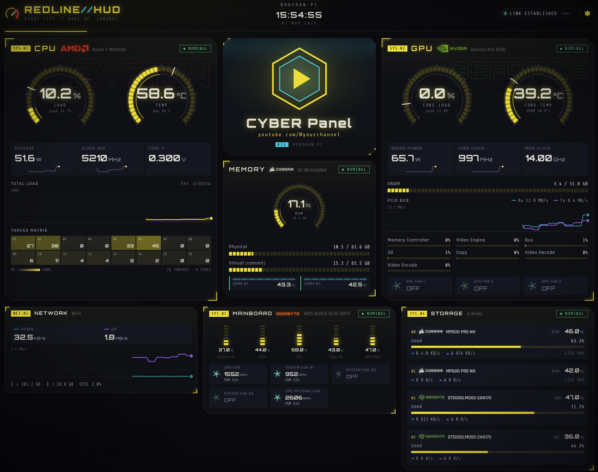
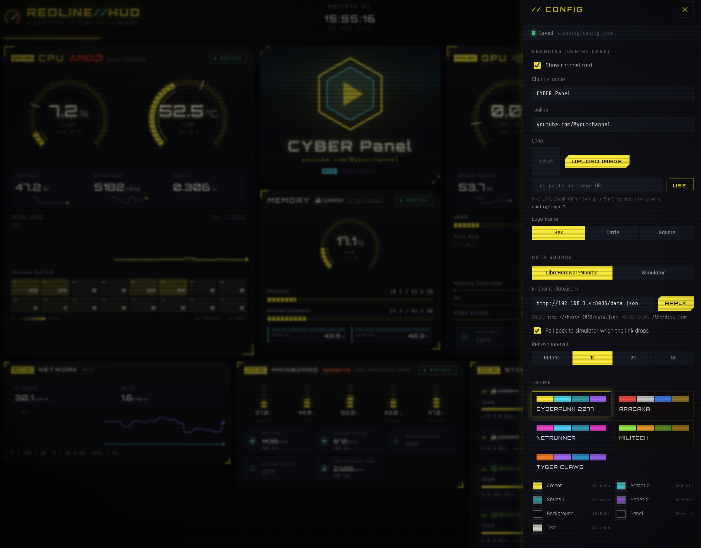

# REDLINE//HUD

A futuristic, themeable hardware-telemetry panel for [LibreHardwareMonitor](https://github.com/LibreHardwareMonitor/LibreHardwareMonitor), built with React + Vite. Its default look is inspired by Cyberpunk 2077.



- **Built for gamers.** CPU and GPU get the big cards, memory comes next, and everything else is compact.
- **Your channel in the middle.** Show your channel name, tagline and logo in the centre of the panel. It's made for streaming overlays and desk displays.
- **Manufacturer logos** are detected from your hardware: AMD, Intel, NVIDIA, ASUS / ROG, MSI, Corsair, Seagate, Samsung and more.
- **Five themes,** starting with Cyberpunk 2077 and including Arasaka, Netrunner, Militech and Tyger Claws. You can override any colour, and turn on CRT scanlines and glitch effects.
- **Fits any screen.** The layout works from a 4K monitor down to a phone in portrait or landscape. The ⛶ button in the header (or the **F** key) makes the panel fullscreen for a desk display or a TV.
- **Settings are saved to `config/config.json`** on disk, so the panel looks the same on every machine that opens it.

<p align="center">
  
</p>

## Download

You don't need Node.js to run the panel. Each [GitHub release](../../releases/latest) comes in two forms for every platform.

### Desktop app

The panel in its own window. It's built with [Tauri](https://tauri.app), so it uses the system webview and the download is only a few MB.

| Platform | File |
|---|---|
| Windows (x64) | `redline-hud-desktop-windows-x64-setup.exe` or `.msi` |
| macOS (Apple silicon) | `redline-hud-desktop-macos-arm64.dmg` |
| macOS (Intel) | `redline-hud-desktop-macos-x64.dmg` |
| Linux (x64) | `redline-hud-desktop-linux-x64.AppImage`, `.deb` or `.rpm` |
| Linux (ARM64) | `redline-hud-desktop-linux-arm64.deb` or `.rpm` |

The desktop app keeps `config.json`, the uploaded logo and `vendors/` in the system's app-config folder. Settings shows the exact path:

| OS | Folder |
|---|---|
| Windows | `%APPDATA%\com.redline-hud.desktop` |
| macOS | `~/Library/Application Support/com.redline-hud.desktop` |
| Linux | `~/.config/com.redline-hud.desktop` |

Zoom works as in a browser: **Ctrl** (**⌘** on macOS) with **+**, **−** or **0**, or Ctrl + mouse wheel. The zoom level resets when the app restarts.

It polls LibreHardwareMonitor itself, so plain `http://` endpoints on your LAN work and the `/lhm` proxy isn't needed. It doesn't serve the panel to other devices. For a tablet or a second PC, use the server app below.

### Server app

A single-file server that you open in any browser, on this machine or across your LAN:

| Platform | File |
|---|---|
| Windows (x64) | `redline-hud-server-windows-x64.zip` |
| macOS (Apple silicon) | `redline-hud-server-macos-arm64.zip` |
| macOS (Intel) | `redline-hud-server-macos-x64.zip` |
| Linux (x64) | `redline-hud-server-linux-x64.tar.gz` |
| Linux (ARM64, e.g. Raspberry Pi 4/5) | `redline-hud-server-linux-arm64.tar.gz` |

Unzip the file, run `redline-hud-server-…`, then open `http://localhost:2077`. The app keeps `config/` (settings, uploaded logo and `vendors/`) in the same folder as the executable. To change the port or bind address, copy `.env.example` to `.env` next to the executable and edit it. `PANEL_HOST`, `PANEL_PORT`, `PANEL_CONFIG_DIR` and `LHM_PROXY_TARGET` are read when the app starts. The `VITE_*` defaults are fixed into the build, so change those in Settings instead.

### First run

Neither app is signed with a paid certificate, so the OS will ask you to confirm the first time:

- **Windows:** SmartScreen may warn about an unrecognised app. Choose *More info → Run anyway*. For the server app, Windows Firewall will ask whether to allow LAN access.
- **macOS:** the apps aren't notarised by Apple, so macOS says it can't verify them. The quickest fix is to remove the quarantine flag in Terminal:
  - server app: `xattr -d com.apple.quarantine redline-hud-server-macos-*`, then run `./redline-hud-server-macos-arm64` (or `-x64`)
  - desktop app: `xattr -dr com.apple.quarantine "/Applications/REDLINE HUD.app"`

  Or open the app once, dismiss the warning, then go to *System Settings → Privacy & Security* and click *Open Anyway*. Since macOS 15, right-click → *Open* no longer skips the check.
- **Linux:** run `chmod +x redline-hud-*` if your extractor or browser dropped the executable bit. The desktop app needs WebKitGTK 4.1, which the `.deb` / `.rpm` pull in.

`SHA256SUMS.txt` on each release lists the checksum of every file.

## Quick start (from source)

```bash
npm install
npm run dev          # http://localhost:2077
```

By default the UI polls `http://192.168.1.4:8085/data.json`. You can change the endpoint, refresh rate, theme, units and channel branding under **⚙ Settings**. Settings are saved to **`config/config.json`** on disk (see [Saved config](#saved-config)).

If you don't have a LibreHardwareMonitor box handy, choose **Simulator** in Settings, or open `http://localhost:2077/?source=mock`.

## Enabling the LibreHardwareMonitor API (Windows host)

1. Run LibreHardwareMonitor **as Administrator** (sensors need ring-0 access).
2. Go to *Options → Remote Web Server → Run* (default port **8085**).
3. Allow inbound TCP 8085 in Windows Firewall.
4. Check it works by opening `http://<host>:8085/data.json` from another machine.

LHM sends `Access-Control-Allow-Origin: *`, so the browser can call it directly. If a build or reverse proxy drops that header, use the dev proxy instead: set the endpoint to `/lhm/data.json` and point `LHM_PROXY_TARGET` in `.env` at the host (see `.env.example`).

## Configuration

| Where | Key | Purpose |
|---|---|---|
| `.env` | `VITE_LHM_URL` | Default endpoint polled by the UI |
| `.env` | `VITE_DATA_SOURCE` | `live` (default) or `mock` |
| `.env` | `LHM_PROXY_TARGET` | Upstream for the `/lhm/*` dev proxy |
| `.env` | `PANEL_CONFIG_DIR` | Folder for `config.json` and the uploaded logo (default `./config`) |
| `.env` | `PANEL_HOST` | Address the dev / preview server binds to (default `0.0.0.0`, all interfaces) |
| `.env` | `PANEL_PORT` | Port for the dev / preview server (default `2077`) |
| URL | `?source=mock&url=…&theme=netrunner` | Overrides for this session only; they are never written to `config.json` |

`npm run dev` and `npm run preview` both listen on `0.0.0.0:2077` by default, so you can open the panel from a tablet or another PC at `http://<this-machine>:2077`. Set `PANEL_HOST=127.0.0.1` to keep it local to this machine. If the port is already in use, the server stops with an error rather than moving to another port. A one-off `npm run dev -- --port 3000` still overrides the setting.

The config API can change settings and upload a logo, and with the default `0.0.0.0` binding anyone on your network can reach it. That's fine on a home LAN, but don't forward the port to the internet.

When the link drops twice in a row, the panel falls back to the simulator and shows a banner. You can turn this off in Settings.

## Layout

The layout follows a gamer's priorities:

1. **CPU** and **GPU** are the large hero panels on the left and right.
2. **Memory** sits in the centre column, under the **channel card**.
3. **Network**, **Mainboard** and **Storage** sit in a compact row below. The sensor index is collapsed at the bottom.

Below about 1240px wide, CPU and GPU sit side by side with the channel card and memory in a strip underneath. Below 760px everything stacks in priority order.

### Channel card

Open **⚙ Settings → Branding** to set your channel name and tagline. You can also upload a logo (PNG, JPG, WebP, GIF or SVG, up to 5 MB) or paste an image URL, and choose a hex, circle or square frame. Untick **Show channel card** to hide the card.

### Manufacturer logos

The CPU, GPU, Mainboard and Memory cards, and each drive, show a badge for the manufacturer. The vendor is detected from the hardware name and ID that LHM reports. Model-number prefixes count too: `ST5000LM000` is detected as Seagate and `CT1000P3` as Crucial. The CPU and GPU cards also show the product line (RYZEN, GEFORCE, CORE ULTRA, …) as large outline text behind the gauges.

The rules are in [src/lib/vendors.ts](src/lib/vendors.ts). They cover:

- **CPU / GPU:** AMD, Intel and NVIDIA.
- **Boards:** the main board makers (ASUS, MSI, Gigabyte, ASRock, …).
- **Drives and RAM:** around 20 brands.

Hardware that isn't recognised gets no badge.

Each badge uses the first of these that is available:

1. **Your own file.** Put an image named after the vendor ID in `config/vendors/`, for example `gigabyte.svg`, `wd.png` or `kingston.webp`. It is picked up on the next page load.
2. **The official logo from [Simple Icons](https://simpleicons.org).** Covered: AMD, Intel, NVIDIA, Qualcomm, Apple, ASUS, ROG, MSI, NZXT, Supermicro, Dell, Alienware, HP, Lenovo, Acer, Samsung, Seagate, Corsair, HyperX, Toshiba and Hitachi. ROG, Alienware and HyperX are chosen when the hardware name mentions them. Symbol-only logos, such as the NVIDIA eye or the Corsair sails, get the brand name set beside them. The mapping is in [src/lib/brandIcons.ts](src/lib/brandIcons.ts).
3. **A wordmark** in the brand's colour, for vendors Simple Icons doesn't have (Gigabyte, ASRock, WD, Crucial, Kingston, G.Skill, SK hynix, …).

Brand colours that are too dark to read on the panel (for example black ASUS or Corsair, navy Samsung) are drawn in the theme's text colour instead. The Simple Icons data is CC0, but the logos are still their owners' trademarks; they are shown only to identify your own hardware. Only the icons listed above end up in the bundle. Under **⚙ Settings → Display → Manufacturer logos** you can choose *Brand colour*, *Theme tint* (single colour, matches the theme) or *Off*.

## Saved config

`npm run dev` and `npm run preview` both serve a small API that stores settings on disk:

| File | Contents |
|---|---|
| `config/config.json` | All settings: source, endpoint, interval, theme and colour overrides, effects, units, branding |
| `config/logo.<ext>` | The uploaded logo (served at `/api/logo`) |
| `config/vendors/<id>.<ext>` | Optional manufacturer logos you add yourself (served read-only at `/api/vendors/…`) |

- **Hand edits:** you can edit `config.json` by hand and reload the page. Values that are unknown or invalid fall back to their defaults.
- **Status:** the Settings drawer shows where the last save went.
- **Static hosting:** if the panel is served by a plain static host with no API (for example a copied `dist/`), settings are kept in browser `localStorage` instead, and uploaded logos are limited to 256 KB.
- **Git:** the `config/` folder is git-ignored.

## Themes

Built-in themes: **Cyberpunk 2077** (default), **Arasaka**, **Netrunner**, **Militech** and **Tyger Claws**. You can override any individual colour from Settings.

Every colour is a CSS custom property (`--c-accent`, `--c-surface`, …) written by `applyTheme()`. To add a theme, append an entry to `THEMES` in [src/lib/themes.ts](src/lib/themes.ts).

The `series1` / `series2` colours drive two-series charts (download/upload, PCIe Rx/Tx). They were checked for colour-vision-deficiency separation and contrast against each theme's panel surface, so if you add a theme, re-validate its pair. Status colours (`good` / `warn` / `crit`) are reserved for severity and always come with an icon and a label.

## Project layout

```
src/
  lib/
    types.ts        LHM data.json node shape + normalised Sensor/Hardware model
    parse.ts        tree → Snapshot (units parsed, throughput normalised to B/s)
    selectors.ts    vendor-agnostic pickers: cpuView, gpuView, memoryView, …
    themes.ts       theme tokens + applyTheme()
    settings.ts     settings hook: config.json via /api/config, localStorage fallback
    vendors.ts      manufacturer detection (name / model-number rules, product lines)
    brandIcons.ts   Simple Icons logo per vendor, sub-brands (ROG, Alienware, HyperX)
    prefs.ts        °C/°F context, severity thresholds
  hooks/useSensorFeed.ts   polling, timeouts, history ring buffer, fallback
  mock/              sample.json (real LHM capture) + drifting simulator
  components/        RadialGauge, LineChart, Meter, CoreGrid, FanDial, Panel, …
  panels/            CPU, GPU, Memory, Network, Mainboard, Storage, Sensor index
server/
  configApi.ts       Vite plugin: /api/config, /api/logo, /api/vendors (dev + preview servers)
  listen.ts          PANEL_HOST / PANEL_PORT → server bind address
  standalone.ts      server for the release executables (UI + config API + /lhm proxy)
src-tauri/
  src/main.rs        desktop app: config / logo / vendor commands, LHM polling, hud: protocol
  tauri.conf.json    window, CSP and installer settings
  app-icon.svg       source for icons/
scripts/
  build-standalone.mjs   packs the server and UI into a Node single executable
.github/workflows/
  release.yml        builds and attaches the server and desktop apps when a release is published
config/              (created at runtime) config.json + logo
```

## Scripts

```bash
npm run dev         # dev server on PANEL_HOST:PANEL_PORT (default 0.0.0.0:2077)
npm run build       # production build → dist/
npm run preview     # serve dist/ (with the config API)
npm run server:build       # server app for this OS → release/
npm run desktop:dev        # desktop app window with hot reload (needs Rust)
npm run desktop:build      # desktop installers for this OS → src-tauri/target/release/bundle/
npm run typecheck
npm test            # unit tests (parser, settings, vendors, config API)
LHM_LIVE_URL=http://192.168.1.4:8085/data.json npm test   # + live endpoint check
```

## Releasing

Publish a release on GitHub (*Releases → Draft a new release*, with a tag such as `v1.1.0`). The [release workflow](.github/workflows/release.yml) then:

1. runs the type-check and tests;
2. builds the server app on Windows, macOS (Apple silicon and Intel) and Linux (x64 and ARM64), starts each one, and checks that it serves the UI and saves config;
3. builds the desktop app on the same platforms. The version is taken from the tag, so `v1.1.0` becomes 1.1.0;
4. attaches each platform's files to the release as soon as that platform passes, then adds `SHA256SUMS.txt`.

If one platform fails, the others are still attached. To try the builds without publishing anything, go to *Actions → Release builds → Run workflow* and leave **tag** empty: the files appear as workflow artifacts only. To rebuild for a release that already exists, for example after fixing a failed platform, enter its tag (such as `v1.1.0`). The new files replace the old ones on that release.

The server app is a [Node.js single executable application](https://nodejs.org/api/single-executable-applications.html): the Node 24 runtime, the bundled server and the built UI in one file. Most of its size, around 100 MB, is the Node runtime. To build one for your own machine, run `npm run server:build`.

The desktop app needs [Rust](https://rustup.rs) and the [Tauri prerequisites](https://tauri.app/start/prerequisites/) for your OS. On Linux that means WebKitGTK 4.1. Then run `npm run desktop:build`. The macOS build gets an ad-hoc signature, which is enough to run it on Apple silicon but not to pass Gatekeeper without the right-click *Open* step. The icons in `src-tauri/icons/` come from `src-tauri/app-icon.svg`; after editing it, run `npx tauri icon src-tauri/app-icon.svg`.
